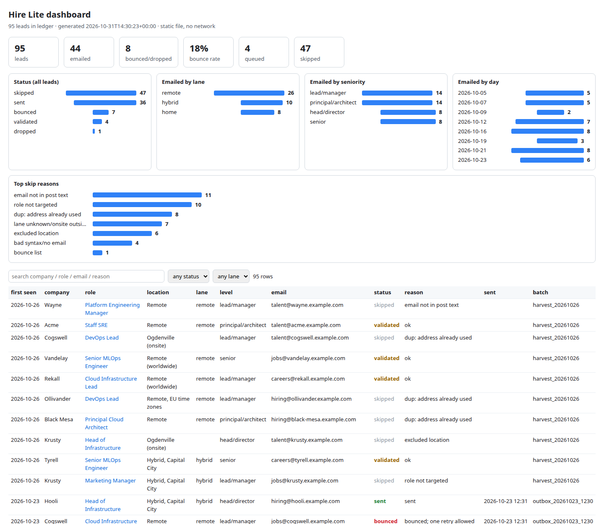

# Hire Lite

**A lean, traceable, email-first agentic job-apply pipeline.** An AI agent finds job posts
that print a hiring email; a small zero-LLM CLI validates, de-duplicates, queues and tracks
every lead in one JSONL ledger; your own laptop sends a fixed, honest email with your fixed
resume; bounces come back into the ledger. Works with Grok Bot, Claude Code, ChatGPT/Codex
or Google Antigravity.



## Why lean and traceable

Most "auto-apply" tools burn tokens driving a browser through ATS portals and leave no
record of what was sent. Hire Lite takes the opposite approach:

- **The agent only does judgement.** One discovery pass per session. Everything else
  (validation, dedupe, queueing, reporting) is deterministic Python with zero LLM calls.
- **Every lead is auditable.** One record per lead with its evidence snippet, status,
  reason and a full status history. A static dashboard shows it all.
- **Rules live in code, not prompts.** "Never guess an email", "no free-mail", "one retry
  per bounce", "home region first" are enforced by `hl.py validate`, so an agent cannot
  forget them.
- **Email only.** No account creation, OTPs, CAPTCHAs, Workday portals or assessments.

## Features

- Ledger CLI (`hl.py`, Python 3.9+, stdlib only): `ingest`, `validate`, `export`,
  `mark-sent`, `mark-bounced`, `retry`, `report`, `dashboard`, `migrate`, `doctor`.
- Validation: syntax, bounce list, free-mail block, email-must-appear-in-evidence,
  duplicate address/url/company+role, excluded companies/locations, target roles,
  lane rules, MX check over DNS-over-HTTPS (cached).
- Lane priority: your home region, then fully remote, then hybrid (configurable).
- Sender: SMTP from your own mailbox, password from the OS keychain (`keyring`) or an env
  var, `--dry-run` with `.eml` previews, per-run and daily caps, delay between sends,
  resend guard. Runs on the agent machine or a separate laptop.
- Bounce checker: read-only IMAP scan for delivery-failure notices.
- One retry per bounce with a published corrected address; a second bounce drops the lead.
- `report`: at most 10 terse lines (the only thing the agent reads).
- `dashboard`: one self-contained HTML file with CSS bar charts and a searchable,
  filterable table. No server, no network, no JavaScript dependencies.
- Discovery helper for Hacker News "Who is hiring?" threads (public APIs).
- Agent adapters for Grok Bot, Claude Code, ChatGPT/Codex and Google Antigravity.

## Quickstart

```bash
git clone https://github.com/shahmeetk/hire-lite.git && cd hire-lite
python3 -m pip install -r requirements.txt   # optional: keyring + PyYAML
python3 hl.py init                            # creates config.yaml, .env, harvest/, results/
```

1. Edit `config.yaml`: your profile, target roles, lanes (put your home region keywords in
   the first lane), excluded locations/companies and caps.
2. Edit `templates/email.txt` once. Placeholders: `$company $role $url $name $headline
   $base_location $notice_period $work_mode $highlights $email $links`.
3. Put your resume next to `config.yaml` as `resume.pdf` (git-ignored).
4. Store your mailbox app password in the keychain (see [docs/SENDER.md](docs/SENDER.md)):
   `python3 -m keyring set hire-lite-smtp you@example.com`
5. `python3 hl.py doctor`

Try the whole loop on synthetic data first (sends nothing, no DNS):

```bash
bash scripts/demo.sh
```

## Run procedure

The agent follows [AGENTS.md](AGENTS.md). In short:

| Step | Who | Command |
|---|---|---|
| 1. Discover (one pass) | agent | writes `harvest/YYYYMMDD.jsonl` (optional: `hl.py discover-hn`) |
| 2. Ingest | CLI | `python3 hl.py ingest harvest/YYYYMMDD.jsonl` |
| 3. Validate | CLI | `python3 hl.py validate` |
| 4. Export | CLI | `python3 hl.py export` writes `outbox.jsonl` |
| 5. Send + bounce check | sender machine | `bash scripts/hl_send.sh [MAX] [--dry-run]` |
| 6. Record results | CLI | `python3 hl.py mark-sent results/results_<ts>.jsonl` and `mark-bounced results/bounces_<ts>.txt` |
| 7. One retry per bounce | agent | `python3 hl.py retry <bounced> <corrected> "<where found>"` |
| 8. Report | CLI | `python3 hl.py report` and `python3 hl.py dashboard` |

If the sender machine is offline, the agent stops after step 4; validated leads stay
queued in the ledger and go out next run. The reference schedule is Monday, Wednesday
and Friday at midday (agent routine or cron; see [adapters/README.md](adapters/README.md)).

The harvest line format:

```json
{"company": "Acme", "role": "Senior Platform Engineer (Remote)", "url": "https://jobs.example.com/acme/101",
 "to": "careers@acme.example.com", "location": "Remote", "posted_date": "2026-11-01",
 "email_source": "post body", "evidence": "Send your CV to careers@acme.example.com"}
```

## Agent setup

| Agent | Start here |
|---|---|
| Grok Bot | [adapters/grok/ROUTINE_PROMPT.md](adapters/grok/ROUTINE_PROMPT.md) and [skill](adapters/grok/skills/hire-lite/SKILL.md) |
| Claude Code | [CLAUDE.md](CLAUDE.md), then run `/hire-lite-run` |
| ChatGPT / Codex | [AGENTS.md](AGENTS.md) (read by Codex), [adapters/chatgpt/INSTRUCTIONS.md](adapters/chatgpt/INSTRUCTIONS.md) |
| Google Antigravity | [.agent/rules/hire-lite.md](.agent/rules/hire-lite.md), [.agent/workflows/hire-lite-run.md](.agent/workflows/hire-lite-run.md) |

## Token-cost philosophy

Tokens are the main running cost, so the design minimizes what the model reads and writes:

- One discovery pass per session, capped by `caps.discovery_queries`; a hard
  `caps.agent_max_turns` budget per session.
- The agent never reads the ledger, logs or dashboard. Every command prints one line;
  `report` prints at most 10.
- No browser automation, screenshots or page dumps; a page is fetched only to confirm a
  printed email and copy a short evidence snippet.
- Fixed resume and template: no per-job generation.
- Deterministic work (dedupe, MX, queueing, charts) costs zero tokens.

## Safety and ethics

You are responsible for every email Hire Lite sends in your name. The defaults are
deliberately conservative:

- **Never guess emails.** Only addresses printed in the post are used, and `validate`
  checks that the address appears in the saved evidence. Free-mail addresses are blocked.
- **No spam.** One relevant application per role, small batches (`caps.export_max`,
  `caps.send_daily_max`), a delay between sends, a resend guard, and immediate handling of
  bounces. Do not raise the caps to blast employers.
- **Respect sites.** Follow each site's terms of service and robots rules, prefer
  official APIs and feeds, do not scrape behind logins, and skip posts that require
  accounts, OTPs, CAPTCHAs or assessments.
- **Honest content.** Your template and highlights must be true. Review a `--dry-run`
  preview before the first real send.
- **Privacy.** Your config, ledger, harvests, results, resume and credentials are
  git-ignored. Hiring contacts' addresses are personal data: keep the ledger private and
  delete it when you are done. CI runs a PII scan and gitleaks on every push.

## Project layout

```
hl.py                  CLI entry point (python3 hl.py <command>)
hire_lite/             ledger, rules, report/dashboard, sender, bounce checker, discovery
templates/             email.txt (and optional email.html) you edit once
config.example.yaml    all settings, placeholders only
AGENTS.md              the agent playbook (all adapters point here)
CLAUDE.md, .claude/    Claude Code adapter
.agent/                Google Antigravity rule + workflow
adapters/              Grok Bot and ChatGPT adapters, scheduling notes
scripts/               hl_send.sh (sender), demo.sh (synthetic dry run), pii_scan.py
examples/              synthetic harvest file and sample ledger
docs/                  architecture, ledger schema, sender setup, dashboard screenshot
tests/                 pytest suite (synthetic data, mocked MX/SMTP)
```

## Documentation

- [Architecture](docs/ARCHITECTURE.md): components, one run, lead status state machine
- [Ledger schema](docs/LEDGER_SCHEMA.md): fields, statuses, validate rules, file formats
- [Sender setup](docs/SENDER.md): app passwords, keychain, separate laptop
- [Contributing](CONTRIBUTING.md) and [Changelog](CHANGELOG.md)

## License

[MIT](LICENSE). Author: Meet Shah ([@shahmeetk](https://github.com/shahmeetk)).
