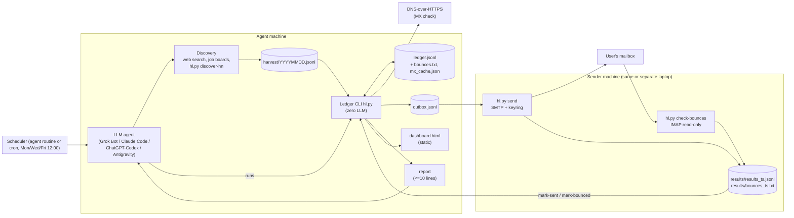
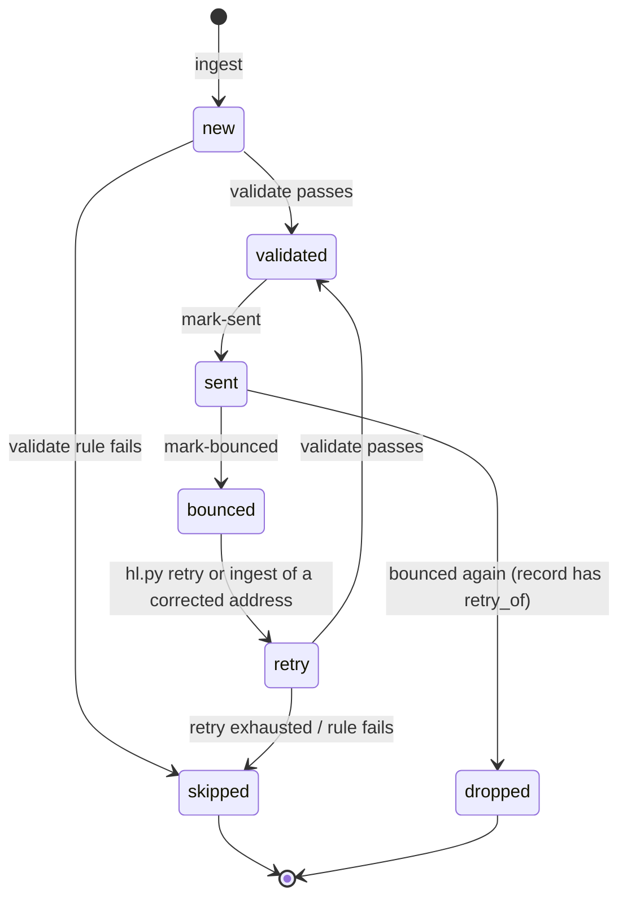

# Architecture

Hire Lite splits the work so that the expensive part (an LLM agent) does only what needs
judgement, and everything else is a deterministic, auditable CLI step.

- **Agent**: one discovery pass, writes a harvest file, runs CLI commands, reads one-line
  outputs, handles the rare bounce retry, sends one summary.
- **Ledger CLI** (`hl.py`, stdlib only): ingest, validate, export, mark-sent, mark-bounced,
  retry, report, dashboard. Zero LLM calls.
- **Sender** (`hl.py send`, `scripts/hl_send.sh`): SMTP from the user's own mailbox on the
  same machine or a separate laptop; password from the OS keychain or an env var.
- **Bounce checker** (`hl.py check-bounces`): read-only IMAP scan for delivery failures.
- **Dashboard**: one static HTML file, no network, no server.

## Components



## One run

```mermaid
sequenceDiagram
    autonumber
    participant S as Scheduler
    participant A as Agent
    participant W as Job sources
    participant H as hl.py (ledger)
    participant X as Sender machine
    participant M as Mailbox

    S->>A: start session (routine prompt)
    A->>W: one discovery pass (<= caps.discovery_queries)
    W-->>A: posts with printed hiring emails
    A->>H: ingest harvest/YYYYMMDD.jsonl
    H-->>A: "ingest added=N dup=M"
    A->>H: validate
    H->>H: syntax, bounce list, free-mail, evidence, dedupe, exclusions, lane
    H->>W: MX lookup (DNS-over-HTTPS, cached)
    H-->>A: "validate validated=N skipped=M"
    A->>H: export
    H-->>A: "export N -> outbox.jsonl"
    alt sender reachable
        A->>X: outbox.jsonl, run scripts/hl_send.sh
        X->>M: SMTP send (caps, delay, resend guard)
        X->>M: IMAP scan for bounces (read-only)
        X-->>A: results_ts.jsonl, bounces_ts.txt
        A->>H: mark-sent, mark-bounced
        opt new bounce with a published corrected address
            A->>H: retry bounced corrected "where found"
        end
    else sender offline
        Note over A,H: stop after export; validated leads stay queued
    end
    A->>H: report, dashboard
    H-->>A: <= 10 lines
    A-->>S: one short summary to the user
```

## Lead status



Notes:

- A `retry` record is a new ledger record (new id, because the id hashes email + url) with
  `retry_of` set to the bounced address. When it is sent and bounces, it becomes `dropped`.
- `new` leads whose MX lookup failed (network error) stay `new` and are retried next run.
- `validated` leads that were not exported (cap reached, sender offline) stay queued.

## Design choices

- **Ledger as JSONL**: append-friendly, diffable, greppable, no database to install. Writes
  are atomic (temp file + rename). Each record keeps a `history` of status changes.
- **Deterministic ids**: `sha1(lower(email) + "|" + url)[:12]` makes ingest idempotent.
- **Rules in code, not prompts**: the agent cannot "forget" a rule because `validate`
  enforces it.
- **Evidence check**: the address must appear in the evidence snippet (obfuscations such as
  `jobs [at] acme [dot] com` are normalized). This is how "never guess" is enforced.
- **Two-machine split**: the sender only needs this repo, `config.yaml`, the template, the
  resume file and `outbox.jsonl`. Results are plain files you copy back.
- **Resend guard**: the sender keeps `sent_register.txt` (address + url) and refuses to send
  the same pair twice, even if an outbox is replayed.
